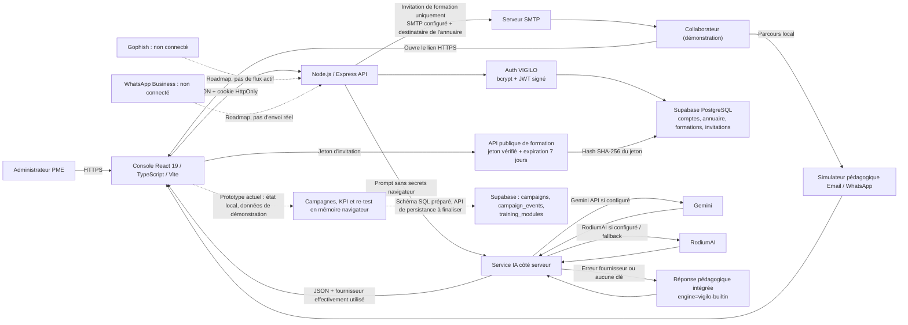

# VIGILO — Architecture de la demi-finale AI4Youth 2026

> Diagramme et description alignés sur le code actuel. Les fonctions simulées et les travaux futurs sont marqués comme tels : ne pas les présenter comme des intégrations déjà opérationnelles.

## Diagramme de bout en bout

## Flux d'exécution expliqué

1. L'administrateur utilise la console web React. L'interface appelle l'API Express sur la même origine avec un cookie de session `HttpOnly`.
2. L'API vérifie le JWT et relit le compte dans Supabase. Les requêtes d'organisation sont filtrées par l'identifiant de l'administrateur authentifié ; le client ne fournit jamais l'identifiant du tenant à faire confiance.
3. Les comptes et l'annuaire (départements et collaborateurs) sont enregistrés dans PostgreSQL. Les mots de passe sont hachés avec bcrypt ; le secret de session et la clé Supabase restent côté serveur.
4. Les fonctions de génération de cas pédagogique, d'analyse agrégée et de micro-formation passent par le backend. Le backend appelle le fournisseur configuré (Gemini ou RodiumAI), peut essayer l'autre fournisseur configuré, puis identifie explicitement le moteur intégré utilisé si les fournisseurs sont indisponibles.
5. Pour l'analyse, le frontend envoie des statistiques agrégées. Le Coach ne reçoit pas de mot de passe ni de contenu de boîte mail. Les mesures de la démo ne sont pas des résultats de pilote.
6. Le parcours de simulation Email/WhatsApp visible est local au prototype. Les événements et campagnes actuels ne sont pas encore chargés/enregistrés depuis les tables `campaigns` et `campaign_events`.
7. Le seul envoi SMTP conservé est une invitation pédagogique à un collaborateur déjà présent dans l'annuaire du tenant. L'envoi de messages de simulation est désactivé. Les intégrations d'envoi Gophish et WhatsApp Business ne sont pas implémentées.

## Stack réellement utilisée

| Couche | Implémentation actuelle |
|---|---|
| Interface | React 19, TypeScript, Vite |
| API | Node.js, Express |
| Authentification | bcrypt, JWT en cookie HttpOnly, contrôles d'accès par tenant |
| Base de données | Supabase PostgreSQL ; clé `service_role` uniquement dans l'environnement serveur |
| IA | SDK Google GenAI pour Gemini ; API compatible OpenAI configurée pour RodiumAI ; secours intégré |
| Email | Nodemailer/SMTP pour les seules invitations de formation autorisées |
| Simulation | Parcours pédagogique local ; campagnes/KPI de démonstration en état React |
| Hébergement cible | Vercel (SPA et fonction Node) ou serveur local avec Vite |

## Données : quoi enregistrer et pourquoi ?

La base est organisée autour d'un compte d'administration, qui constitue actuellement le tenant :

- `admins` : email, hash du mot de passe, entreprise, taille et modules choisis ;
- `departments` : services de l'entreprise, rattachés à `admin_id` ;
- `employees` : annuaire, département et score de démonstration, rattachés au même tenant ;
- `training_modules`, `training_invitations` : contenus pédagogiques et invitations à usage limité (jeton aléatoire stocké sous forme hachée, expiration après 7 jours, complétion enregistrée).
- `campaigns`, `campaign_events` : tables préparées par la migration, mais dont la persistance API/front reste à terminer.

Le prototype ne doit pas garder de noms/emails dans les prompts IA. Pour l'évaluation, utilisez des données synthétiques ; avant un pilote réel, définissez la base légale, l'information des participants, les accès, la durée de conservation, la suppression et les sauvegardes. Évitez les classements nominatifs : privilégiez les résultats agrégés par cohorte.

### Mise en route Supabase

1. Créer un projet Supabase et ouvrir son éditeur SQL.
2. Exécuter une seule fois `supabase/migrations/20261026220000_initial_schema.sql`.
3. Copier `.env.example` vers `.env`, puis renseigner `SUPABASE_URL`, `SUPABASE_SERVICE_ROLE_KEY` et un `SESSION_SECRET` aléatoire.
4. Ne jamais mettre `SUPABASE_SERVICE_ROLE_KEY`, `GEMINI_API_KEY`, `RODIUM_API_KEY` ou `SMTP_PASS` dans le code frontend, Git ou une capture d'écran.
5. Ajouter les mêmes variables aux paramètres d'environnement du déploiement Vercel ; ne pas réutiliser les secrets de développement en production.
6. Lancer `npm run dev`, créer un compte de test, puis vérifier l'annuaire et les départements après rechargement.
7. Activer les sauvegardes et définir la rétention avant toute donnée réelle.

Dans le dépôt et son répertoire `data/`, aucun `admins.json` ou `org.json` local n'est disponible pour une migration. Si vous avez des données ailleurs, ne les supprimez pas : il faudra les exporter puis les importer explicitement dans Supabase.

## Mesures pratiques à défendre au jury

- **Confidentialité :** secrets côté serveur ; accès par session ; requêtes métier limitées au tenant authentifié ; RLS activée et accès navigateur révoqués dans la migration.
- **Minimisation :** seules les statistiques agrégées sont soumises à l'analyse IA ; aucun entraînement/affinage d'un modèle propriétaire n'est revendiqué.
- **Panne IA :** fournisseur secondaire si configuré, sinon réponse de secours intégrée ; la réponse signale le moteur réellement utilisé. Cette réponse intégrée n'est pas une IA hors ligne.
- **Connectivité :** l'interface et les scénarios de démonstration chargés localement peuvent être montrés sans envoi externe ; l'authentification, Supabase et l'inférence distante demandent une connexion.
- **Coût :** aucun coût par utilisateur n'est encore mesuré. Pour un pilote, relever nombre d'appels IA, coût facturé, volume SMTP et coût Supabase avant de promettre une marge.
- **Scalabilité :** Express peut être déployé en fonction Node stateless ; Postgres est le stockage partagé. Les campagnes réelles, files d'attente et tests de charge sont des travaux futurs.
- **Erreur/récupération :** réponses API explicites en cas d'absence de configuration ; ne pas transformer une indisponibilité en faux succès.

## Script oral (≈ 60 secondes)

> « VIGILO sépare la console web, le backend et les données. La console React parle à une API Node/Express qui vérifie la session et enregistre les comptes et l'annuaire dans Supabase PostgreSQL. Pour le Coach, seul le serveur détient les clés Gemini ou RodiumAI ; il analyse des indicateurs agrégés et indique le moteur qui a réellement répondu, avec un secours pédagogique en cas de panne. Aujourd'hui, les parcours de simulation et leurs KPI restent ceux du prototype, et ne sont pas des résultats de pilote. SMTP sert uniquement aux invitations de formation autorisées ; WhatsApp Business et Gophish ne sont pas connectés. La prochaine étape est de persister campagnes et événements, puis de valider confidentialité, coûts et usage avec des PME pilotes. »

## Questions probables

**Vos modèles sont-ils entraînés sur des données togolaises ?**
Non. Nous appelons un modèle externe avec des instructions de sensibilisation contextualisées ; nous ne revendiquons ni dataset d'entraînement local ni fine-tuning. Les sorties doivent être évaluées et validées par des personnes avant usage.

**Où sont stockées les campagnes ?**
Dans le prototype actuel, elles sont en mémoire dans l'interface et certaines sont des données de démonstration. La migration Supabase prépare les tables campagnes/événements, mais l'API et le branchement frontend de persistance restent à achever.

**Envoyez-vous déjà des simulations par WhatsApp ou Gophish ?**
Non. Le parcours WhatsApp est une simulation dans l'interface ; les connecteurs d'envoi réels ne sont pas implémentés. L'endpoint d'envoi de simulations est désactivé dans cette version.

**Que se passe-t-il si le service IA ne répond pas ?**
Le backend essaie le fournisseur secondaire lorsqu'il est configuré, puis renvoie une réponse de secours pédagogique et l'indique dans `engine`/`warning`. Cette solution de secours ne réalise pas d'inférence hors ligne.

**Comment démontrez-vous l'impact ?**
À ce stade, nous montrons le parcours et les KPI de démonstration, pas une baisse mesurée des incidents. Un pilote devra établir une référence, informer les participants, comparer un re-test autorisé et publier des résultats agrégés.
